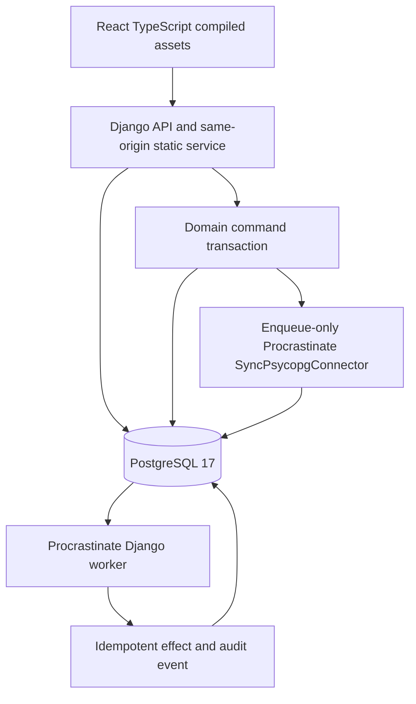

# M0 architecture notes — candidate engineering foundation

**Governing design:** Employee Onboarding Companion Technical Architecture & Engineering Handoff v1.0 (owner-provided). This page documents only the M0 implementation, not the final product.

- One PostgreSQL transaction writes operation, audit event and Procrastinate job. See `backend/jobs/atomic.py` and `backend/foundation/services.py`.
- The Django Procrastinate connector handles migration and workers; it **does not** support external connections. The enqueue-only sync connector handles atomic insert on Django's native psycopg connection. See ADR 0001 and qualification tests.
- The worker may execute at least once, not exactly once. A unique one-to-one effect and a unique audit event prevent duplicate authoritative outcomes.
- The hard-kill recovery script exercises worker termination immediately after a committed domain effect but before queue acknowledgment, then documented stalled-job retry.
- The audit table currently contains temporary probe events. Append-only runtime access is only a candidate; M0 checks restricted-role feasibility, while the final audit schema/grants belong to M1.
- React is a truthful foundation-only page served by Django; no employee onboarding UI or authoritative product state exists yet.
- S3, ClamAV, AI and hosting are later gated milestones, not active M0 dependencies.

### Qualification gate

Source compilation does not qualify database behavior. The private GitHub Actions workflow runs real Postgres transactions, worker crash/recovery, Django/React smoke checks, and restricted-role feasibility. Docker build must be exercised separately in CI before container viability can be marked qualified.

No paid resources or public application are involved.
