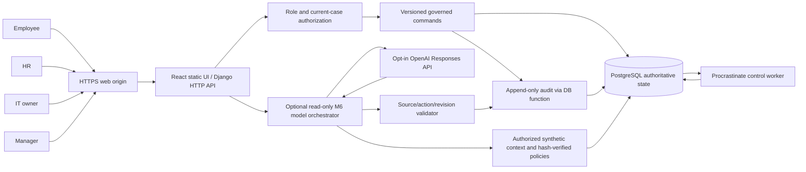
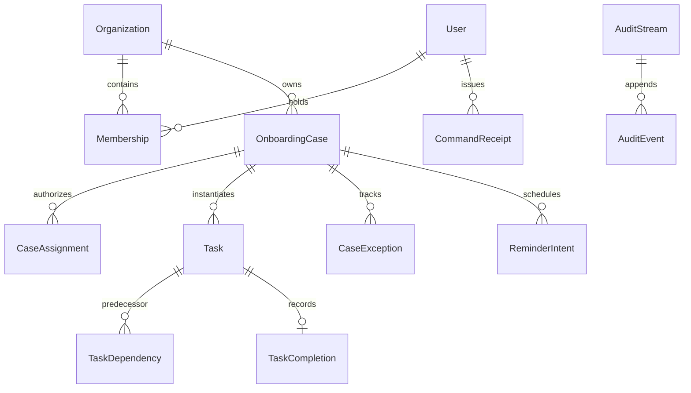
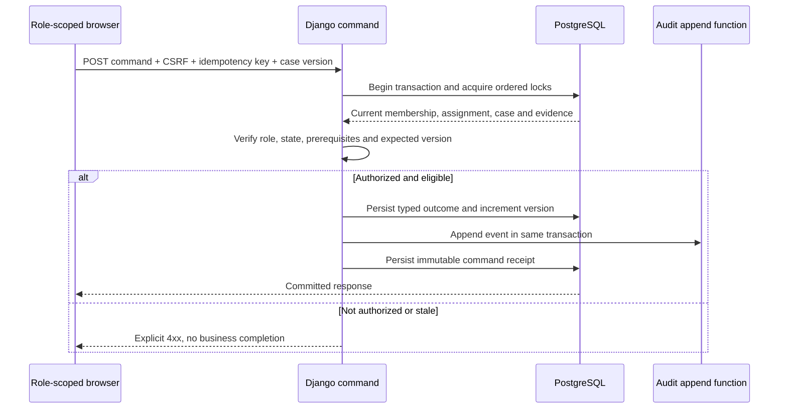

# Employee Onboarding Companion — implementation technical design

**Version:** submission candidate, 10 October 2026. **Not a production security sign-off.**
**Governing source:** PRD v1.1, Business Journey v1.0, revised 8 October brief.
**Branch:** `feature/m5-m6-parallel-development`. No changes to protected `main`.
**Evidence boundary:** The implementation described here is visible in the repository;
a successful hosted system and J01–J05 cannot be inferred from source alone.

## 1. System context

The product is one Django-served web application. React/TypeScript is built
as static assets and fetched from the same origin as the session-based JSON
API. Four actor roles interact with one PostgreSQL-backed authoritative
workflow engine: Employee, HR, IT, Manager. A periodic Procrastinate worker
reconciles reminders and reviews/owner escalations.

No tool in the AI pipeline can execute `CMD`. The diagram's `EXT` edge
exists only when the owner explicitly enables/configures an authorized API
provider and the application has access to the private credential.
`EXT` has not been exercised in a real hosted qualification.

## 2. Technology and packaging

| Layer | Selected mechanism | Why and constraints |
| --- | --- | --- |
| UI | React/TypeScript + Vite | Builds to local Django static root, same-origin login and CSRF |
| Application | Django 5.2 + Gunicorn | Typed, role-scoped JSON endpoints and transaction boundaries |
| Database | PostgreSQL | Single source of authority for cases, tasks, audit, receipts, queue |
| Async | Procrastinate + PostgreSQL | Persistent, retryable scheduled/periodic jobs; worker required in hosting |
| Auth | Django sessions, Argon2 password hashing | Four membership roles, revocation and case assignments |
| Audit | Append-only hash-chained PostgreSQL event append function | Actor/command/transition provenance separate from business task writes |
| AI | Deterministic fallback; opt-in Responses API with strict schema | No model claimed without external inference and validation |
| Document security | Conditional quarantine, scanning and versioned review | **Disabled** for proposed public demo until secure storage/scanner qualify |
| Hosting candidate | Render Docker web, private Postgres, control worker | Blueprint is prepared, not deployed; worker has paid cost |

Host migration strategy is additive: apply the already-reviewed migrations
without rewriting historical migration files. Test a fresh empty database and
upgrade path before declaring database release safe.

## 3. Main domain objects

A case snapshots a published template edition. Dependency states are
computed from prerequisite *typed* completions. Starting a task does not
complete it; requesting IT access does not fulfill it. Rejected document
revisions remain historical, and newer documents need an authorized
review decision. Task ownership is a time-bound case assignment and
current authorization, not a client-supplied role. Organization and
case identity are checked on every protected read and mutation.

A case closeout command accepts **no bypass fields**. It rechecks HR
authorization, active case state, applicable mandatory task evidence and
all unclosed exception episodes under the authoritative case lock,
then writes the snapshot, closeout event and receipt atomically.

## 4. State and command integrity

The browser cannot set arbitrary task `COMPLETED` or case
`COMPLETED` status. Case operations use an `If-Match` case-version
precondition and UUID idempotency key. Server re-authorizes against
current membership, active assignments and case version. Existing
hard-crash and interrupted upload recovery tests apply only to the
specific prior commits where they passed, not automatically to a new
hosted environment.

## 5. AI trust boundary and cost

The opt-in `POST /api/v1/cases/{case_id}/companion/answer` receives
only a bounded (1–400 character) explicit question. It constructs a
server-authorized current context from task states, eligible action IDs,
blocker IDs and source IDs, with HR/Employee-only case-assigned
hash-verified policy editions. No uploads, credentials, employee email,
form answers or exception free-text notes enter that context.

If `EOC_AI_PROVIDER != OPENAI` or `OPENAI_API_KEY` is absent, the
response is labelled `DETERMINISTIC_FALLBACK` and
`ai_model_used=false`. With explicit configuration, a fixed HTTPS
Responses endpoint is called with model specified by `EOC_AI_MODEL`
(default `gpt-4o-mini`), output token cap 650, maximum context
payload 16 KB, 12-second network timeout and strict JSON schema.
The application bounds attempts at **three per user over 24 hours**
by reserving audited attempts under a user row lock. This is a *token
and call bound*, **not a verified monetary maximum**.

The validator checks exact keys, source IDs, actionable IDs, blockers,
allowed answer types, lengths and current authorized case digest.
Only an accepted response is labelled `MODEL_VALIDATED`;
validated answer hash, citations and token usage are written to the
existing append-only audit stream. A provider failure or rejected
citation returns **clearly labelled deterministic** guidance. Questions,
credentials and unvalidated model text are not written to the audit
record. No model can call mutating workflow functions. No genuine
external inference has yet been observed or approved by a live run.

## 6. Deployment controls

The candidate Render Blueprint intentionally disables auto-deploy,
debug mode, secure document intake and model access by default.
Render's `RENDER_EXTERNAL_HOSTNAME` sets the exact allowed web host;
the HTTPS proxy scheme is accepted only when `RENDER=true`.
Managed `DATABASE_URL` maps to the Django PostgreSQL connection.
Static files are generated by the multistage Docker build.

The web service runs forward migrations and Gunicorn. The
`control` worker separately processes PostgreSQL-backed periodic
jobs. If the worker is unavailable, serving the web UI **does not mean**
background reminders/escalations are functioning. The free web tier
has no interactive shell and can sleep; the proposed worker tier
is paid and requires explicit owner approval.

Provision one set of synthetic demo role identities through
`seed_hosted_synthetic` in the authenticated paid-worker shell
after securely configuring private credential environment variables.
Do not enable debug on hosted services. Remove bootstrap secrets
and disable the bootstrap flag immediately after the one-time run.
The demo seed refuses duplicates and prints no passwords.

See [the full hosting and acceptance runbook](hosting-and-acceptance.md).

## 7. Verification matrix and unqualified gaps

**Historical evidence:** Earlier M5 Chromium and M3–M4 Chromium
runs passed on preceding source versions. An earlier M5–M6 PostgreSQL
run reported 165 passed, 2 skipped and 2 fixture errors; both fixture
errors were subsequently corrected in source, with no current-SHA PASS
yet established here. The historical M3 secure-upload crash evidence
does not prove deployed S3 scanning.

**New candidate tests:** hosted seed gate and secrecy, M6
allowlisted-policy/model validation, bounded rate/audit and failure
fallback, M7 typed-evidence HR closeout and idempotency. These tests
need an exact-HEAD self-hosted Ubuntu ARM64/PostgreSQL run and code
review before qualification.

**Mandatory hosted journeys:**
J01 complete/closed onboarding,
J02 rejected/replaced document,
J03 blocked/resolved IT with reminder,
J04 real source-grounded/unsupported model questions,
J05 unauthorized access, idempotency and rollback.
None is accepted without real deployed browser, roles, timestamps,
responses, persisted evidence and exact deployed SHA.

**Other material limitations:** no authenticated hosted deployment
connection completed; no reachable URL; no live model credential;
secure document storage/scanning disabled; no production backup,
monitoring or recovery qualification; no measured business
improvement benchmark; no recorded hosted demo video; independent
M2/security and final release gates open. The UI and API must be
retested together against the deployed SHA before presenting as
a finished product.

## 8. Operating and review instructions

1. Run backend PostgreSQL tests for escalation, new model and
   closeout changes, then targeted full regression and Chromium on
   **the exact branch SHA**.
2. On first deployment, verify `/health/live`, `/health/ready`,
   front-end assets, session/cookie/CSRF, workers, migrations and
   exact `RENDER_GIT_COMMIT` before user-flow claims.
3. Use synthetic identities and cases only. Execute J01–J05, capture
   actual evidence and repair material failures. Separate SOURCE GO
   from browser, infrastructure and production acceptance.
4. Capture a genuine hosted walkthrough video and include the
   URL, code access, technical design, deployment instructions,
   test evidence and known limitations in the submission.
5. Do not activate paid hosting, a third-party AI API or public
   distribution without owner's explicit authority.
